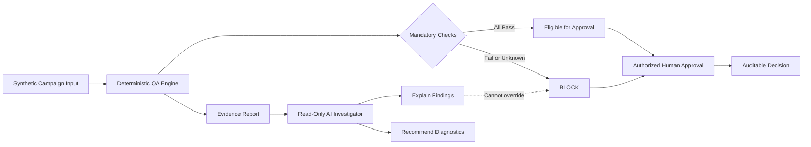
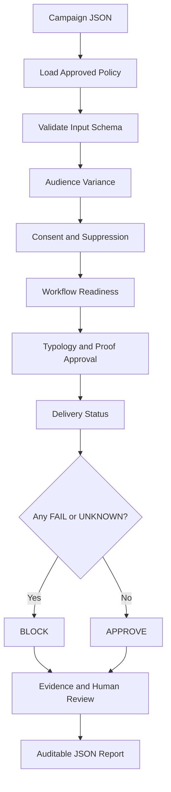
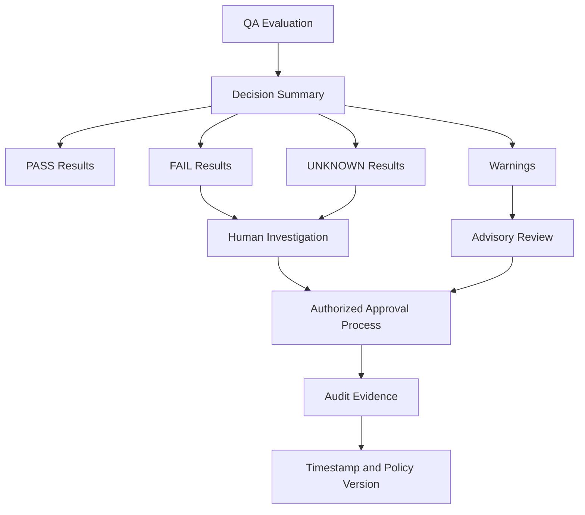

# Adobe Campaign v8 Governance

An independent reference project demonstrating deterministic campaign governance and controlled AI-assisted investigation patterns.

This project uses synthetic examples only. It does not connect to a production Adobe Campaign instance.

## Architecture

```text
Synthetic Campaign Input
          |
          v
Deterministic Pre-Flight Engine
          |
          v
Policy Validation
          |
     +----+----+
     |         |
   PASS       BLOCK
     |         |
     v         v
Evidence Report / Human Review
```

AI-assisted investigation is a separate layer. It may explain evidence and recommend diagnostics, but it cannot override a mandatory deterministic block.

## Repository contents

- `docs/` — architecture and governance baseline
- `src/acc_v8_qa/` — Python validation engine
- `config/` — configurable policy
- `samples/` — synthetic campaign examples
- `tests/` — automated test suite
- `.github/workflows/` — continuous integration

## Run locally

```bash
python -m venv .venv
source .venv/bin/activate
pip install -r requirements.txt

PYTHONPATH=src pytest -v

PYTHONPATH=src python -m acc_v8_qa.cli samples/campaign-pass.json
```

To evaluate a blocking example:

```bash
PYTHONPATH=src python -m acc_v8_qa.cli samples/campaign-fail.json
```

The blocking example intentionally returns exit code 1.

## Governance controls

- Audience variance against a configurable baseline.
- Consent and suppression evidence.
- Workflow completion.
- Mandatory typology activation.
- Explicit human proof approval.
- Asynchronous delivery status.
- Advisory content checks.
- Machine-readable evidence reports.

## Safety model

A mandatory `FAIL` or `UNKNOWN` produces `BLOCK`.

Warnings are advisory and cannot independently create a blocking decision.

No campaign execution, automatic override, or production integration is implemented.

## Scope and disclaimer

This is an independent educational reference implementation. It is not affiliated with or endorsed by Adobe. Product capabilities, schemas, thresholds, and deployment details must be verified against current official documentation and the intended environment.

All sample data is synthetic. Do not add employer, customer, tenant, market, recipient, or confidential operational information.

---

## Visual Architecture

### 1. End-to-End Governance Architecture

The deterministic engine owns approval decisions. The AI investigator is read-only and cannot override mandatory controls.



### 2. Deterministic Pre-Flight QA Flow



### 3. Governance Dashboard and Approval Flow



### Governance Principles

| Principle | Enforcement |
|---|---|
| Deterministic controls | Mandatory rules determine the gate outcome |
| Fail-closed | FAIL or UNKNOWN blocks approval |
| AI separation | AI investigates; it cannot override |
| Human accountability | Authorized human review |
| Traceability | Evidence, timestamps and policy versions |
| Synthetic data | No customer or production records |


---

## Interactive Governance Dashboard

The repository includes a Streamlit interface for running the deterministic
pre-flight engine against bundled examples or synthetic JSON uploads.

### Run locally

```bash
pip install -r requirements.txt
streamlit run streamlit_app.py
```

### Dashboard capabilities

- Select a bundled passing or blocking example.
- Upload a JSON campaign payload (256 KB maximum).
- Validate input structure and field types.
- View APPROVE or BLOCK decisions.
- Inspect PASS, FAIL, UNKNOWN and WARN results.
- Download a JSON evidence report.

### Security and governance boundaries

- Synthetic data only.
- No production Adobe Campaign connection.
- No campaign execution.
- No uploaded-file persistence.
- No AI override or automatic approval.
- Unexpected JSON fields and malformed inputs are rejected.
- Mandatory FAIL or UNKNOWN results remain blocking.

The dashboard is an educational reference interface, not a production
campaign approval system.

## v2 Explainable Investigation

The v2 release adds an offline, read-only investigation layer that consumes
the deterministic QA evidence report.

### Capabilities

- Maps known QA rule findings to generic diagnostic explanations.
- Classifies findings by advisory risk: CRITICAL, HIGH or LOW.
- Recommends evidence a human reviewer should collect.
- Marks findings for human review.
- Flags unknown rule identifiers as unclassified rather than guessing.
- Exports the QA and investigation reports together.

### Decision authority and limitations

The deterministic QA engine remains the sole source of the APPROVE/BLOCK
decision. The investigation layer cannot change the decision, policy,
approval state or campaign execution.

This release does not call an LLM, external API or production platform.
Recommendations are generic diagnostic guidance, not verified root causes.
All examples must remain synthetic.

## v3 — Enterprise Governance Portfolio Control Tower

V3 extends the V2 single-campaign demonstration into a synthetic
multi-campaign portfolio assessment experience.

### Portfolio capabilities

- Assess multiple synthetic campaigns in one batch.
- Reuse the V2 deterministic QA engine without changing its decision logic.
- Reuse V2 read-only investigation explanations.
- Summarise APPROVE/BLOCK decisions and CRITICAL/HIGH/MODERATE/LOW risk.
- Aggregate FAIL and UNKNOWN occurrences by governance control.
- Retain timestamped assessment batches in local JSON.
- Export portfolio results as CSV.
- Inspect campaign-level findings and human-review indicators.

### Local storage

- `data/synthetic_campaign_portfolio.json` — synthetic campaign inputs.
- `data/portfolio_assessments.json` — append-only assessment history.

The history writer uses atomic file replacement. This is a local prototype,
not a tamper-proof or multi-user audit ledger. It does not provide database
transactions, access control, cryptographic signing or immutable storage.

### V3 decision boundary

Every campaign is assessed by the existing deterministic engine.
The portfolio layer aggregates results; it does not change individual
APPROVE/BLOCK decisions. Investigation remains advisory and read-only.

All campaign data is synthetic. No production connectors, customer records,
external APIs or campaign execution are included.

## v3.1 — Governance OS

V3.1 introduces a redesigned workspace with navigation for Executive
Overview, Campaign QA, Campaign Portfolio, Risk Intelligence,
Approval Centre, Audit Ledger and Policy Registry.

### Human approval

- Records reviewer identity, action, rationale and UTC timestamp.
- Supports APPROVE, REJECT and REQUEST_CHANGES for eligible cases.
- A deterministic BLOCK campaign cannot be approved or released.
- Review records explicitly carry `release_authorized: false`.

### Audit ledger

- Assessment and human-review events are recorded locally.
- Events are linked with SHA-256 hashes.
- Chain verification detects accidental or partial record modification.
- Appending is refused when an existing chain fails verification.

### Important prototype limitations

The local JSON files are not a production-grade immutable ledger.
Hash chaining is tamper-evident, not tamper-proof against an administrator
who can rewrite the entire file and recompute the chain. Local JSON storage
does not provide multi-user transactions, authentication, authorization,
or concurrent-write protection. Reviewer identity is self-asserted in
this synthetic demonstration.

No campaign execution or release integration is provided.


## Public demo and zero-cost hosting

- **Portfolio landing page:** https://sghatge.github.io/adobe-campaign-v8-governance/
- **Interactive Streamlit demo:** https://adobe-campaign-v8-governance-3rzwjb2pbqqftpm3fecxzd.streamlit.app/

The static landing page is deployed from `docs/` using GitHub Pages and GitHub Actions. It is separate from the interactive application, so the project overview remains available even when the Streamlit demo is sleeping.

The interactive demo uses Streamlit Community Cloud's free hosting tier. Free apps may sleep after inactivity and require a short wake-up delay. This is expected free-tier behaviour, not a paid uptime guarantee.

No paid database, API key, or external AI service is required for the synthetic demonstration. Assessment history, human-review records and the hash-chained audit ledger currently use local JSON files in the app runtime; persistence across hosting restarts is not guaranteed. Download evidence exports when you need to retain a copy.

### Free hosting architecture

```text
GitHub repository
  |-- docs/ ----------------> GitHub Pages (static project front door)
  |
  |-- streamlit_app.py -----> Streamlit Community Cloud (interactive demo)
  |
  |-- .github/workflows/ ---> GitHub Actions (automated Pages deployment)
```

All examples remain synthetic. No production campaign connection or execution is provided.

## Campaign Guardian Phase 1

The integrated Campaign Guardian adds deterministic, evidence-linked recommendations, a non-compensable compliance evaluator, a five-iteration maximum review loop, and versioned candidate playbooks. Candidate versions remain pending until a human reviewer records an explicit decision in the existing hash-chained audit ledger.

Missing consent evidence or legal-basis evidence returns BLOCK. A quality score is descriptive and cannot change that gate. Guardian recommendations are offline and rule-based; no LLM, paid API, production connector, campaign execution, or deployment is included. Synthetic evidence references are required by the QA engine.

Use the Campaign Guardian section in the existing Streamlit Governance OS to evaluate bundled scenarios, inspect recommendations, create a candidate playbook, and approve or reject it as a human reviewer. Candidate playbook approval does not authorize a campaign release.

See [Campaign Guardian Phase 1 technical notes](docs/CAMPAIGN_GUARDIAN_PHASE_1.md) for the architecture, acceptance criteria, controls, and limitations.

## Campaign Guardian Phase 2 — free governance hardening

Phase 2 adds an operator-readable audit integrity report and a JSON export that includes the verification result. Before a human reviews a candidate playbook, the existing Governance OS shows recommendation additions/removals and whether invariant metadata matches the active version.

This remains a free, synthetic local prototype. No paid APIs, database, authentication provider, external LLM, live Adobe/Salesforce connection, campaign execution, or new deployment behavior is included. Local JSON persistence can be lost on a hosted app restart. Hash chaining is tamper-evident but does not detect a full rewrite and rehash of the ledger; the export is not a signature or immutable archive. Reviewer identity is still self-entered.

See docs/CAMPAIGN_GUARDIAN_PHASE_2.md for the Phase 2 controls and local run instructions.


## Campaign Guardian Phase 3 — portable review packet

The existing Campaign Guardian page can now export one JSON review packet for a synthetic evaluation. It bundles the deterministic decision, policy version, rule checks, recommendations, bounded-loop history, and current audit-chain integrity. The packet omits the raw campaign payload and always records `release_authorized: false`. Exporting is local UI behavior; no paid service, database, or production connector is required.


## Campaign Guardian Phase 4 — review packet integrity

Guardian review packets now include a SHA-256 digest over their contents. The app reports whether the exported packet digest matches its contents, and automated coverage confirms that edits are detected. This digest is tamper-evident for accidental or uncoordinated changes; it is not a digital signature and does not prove who created the packet. No paid service or external dependency is added.


## Campaign Guardian Phase 5 — offline packet verification

The Campaign Guardian page can verify a previously downloaded review packet. Upload a JSON packet to check whether its SHA-256 digest matches its contents; modified or malformed files are reported as invalid. Uploaded packet data is processed in memory, limited to 256 KB, and is not written to app storage. This verifies integrity only, not who created the packet. Keep using synthetic data.
