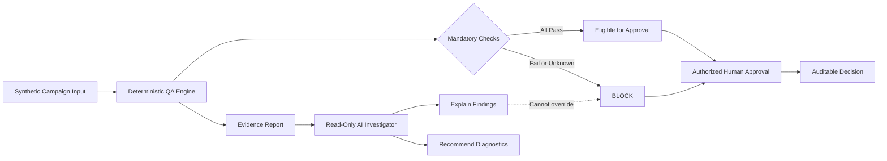
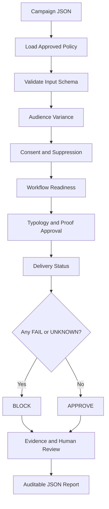
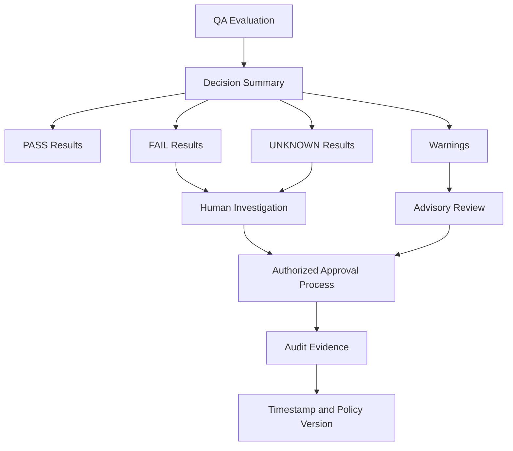

# Adobe Campaign v8 Governance

An independent reference project demonstrating deterministic campaign governance and controlled AI-assisted investigation patterns.

This project uses synthetic examples only. It does not connect to a production Adobe Campaign instance.

## Architecture

```text
Synthetic Campaign Input
          |
          v
Deterministic Pre-Flight Engine
          |
          v
Policy Validation
          |
     +----+----+
     |         |
   PASS       BLOCK
     |         |
     v         v
Evidence Report / Human Review
```

AI-assisted investigation is a separate layer. It may explain evidence and recommend diagnostics, but it cannot override a mandatory deterministic block.

## Repository contents

- `docs/` — architecture and governance baseline
- `src/acc_v8_qa/` — Python validation engine
- `config/` — configurable policy
- `samples/` — synthetic campaign examples
- `tests/` — automated test suite
- `.github/workflows/` — continuous integration

## Run locally

```bash
python -m venv .venv
source .venv/bin/activate
pip install -r requirements.txt

PYTHONPATH=src pytest -v

PYTHONPATH=src python -m acc_v8_qa.cli samples/campaign-pass.json
```

To evaluate a blocking example:

```bash
PYTHONPATH=src python -m acc_v8_qa.cli samples/campaign-fail.json
```

The blocking example intentionally returns exit code 1.

## Governance controls

- Audience variance against a configurable baseline.
- Consent and suppression evidence.
- Workflow completion.
- Mandatory typology activation.
- Explicit human proof approval.
- Asynchronous delivery status.
- Advisory content checks.
- Machine-readable evidence reports.

## Safety model

A mandatory `FAIL` or `UNKNOWN` produces `BLOCK`.

Warnings are advisory and cannot independently create a blocking decision.

No campaign execution, automatic override, or production integration is implemented.

## Scope and disclaimer

This is an independent educational reference implementation. It is not affiliated with or endorsed by Adobe. Product capabilities, schemas, thresholds, and deployment details must be verified against current official documentation and the intended environment.

All sample data is synthetic. Do not add employer, customer, tenant, market, recipient, or confidential operational information.

---

## Visual Architecture

### 1. End-to-End Governance Architecture

The deterministic engine owns approval decisions. The AI investigator is read-only and cannot override mandatory controls.



### 2. Deterministic Pre-Flight QA Flow



### 3. Governance Dashboard and Approval Flow



### Governance Principles

| Principle | Enforcement |
|---|---|
| Deterministic controls | Mandatory rules determine the gate outcome |
| Fail-closed | FAIL or UNKNOWN blocks approval |
| AI separation | AI investigates; it cannot override |
| Human accountability | Authorized human review |
| Traceability | Evidence, timestamps and policy versions |
| Synthetic data | No customer or production records |


---

## Interactive Governance Dashboard

The repository includes a Streamlit interface for running the deterministic
pre-flight engine against bundled examples or synthetic JSON uploads.

### Run locally

```bash
pip install -r requirements.txt
streamlit run streamlit_app.py
```

### Dashboard capabilities

- Select a bundled passing or blocking example.
- Upload a JSON campaign payload (256 KB maximum).
- Validate input structure and field types.
- View APPROVE or BLOCK decisions.
- Inspect PASS, FAIL, UNKNOWN and WARN results.
- Download a JSON evidence report.

### Security and governance boundaries

- Synthetic data only.
- No production Adobe Campaign connection.
- No campaign execution.
- No uploaded-file persistence.
- No AI override or automatic approval.
- Unexpected JSON fields and malformed inputs are rejected.
- Mandatory FAIL or UNKNOWN results remain blocking.

The dashboard is an educational reference interface, not a production
campaign approval system.
